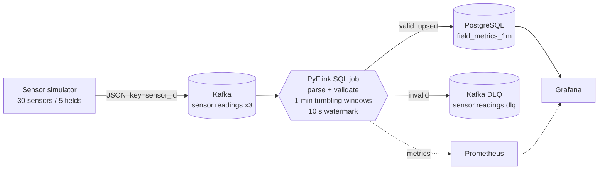

<<<<<<< HEAD
# Agristream-Realtime-Analytics-Pipeline
Production-ready streaming pipeline leveraging Apache Kafka for data ingestion, PyFlink for real-time windowed aggregation, and PostgreSQL for operational analytics storage. Containerized end-to-end with Docker
=======
# Agristream Realtime Analytics Pipeline

Production-style streaming pipeline for agricultural IoT telemetry: **Apache Kafka** (KRaft) for ingestion, **PyFlink** for event-time windowed aggregation, and **PostgreSQL** for operational analytics. Containerized end-to-end with Docker Compose, with optional Prometheus + Grafana observability.



## Highlights

| Concern | Approach |
|---|---|
| Time semantics | Event time from the sensor + 10 s bounded out-of-orderness watermark; simulator injects late events to exercise it |
| Delivery guarantees | Checkpointed (exactly-once state) + at-least-once JDBC sink with **primary-key upsert** = effectively-once results |
| Poison pills | Source read as raw text and parsed in SQL; bad records go to a **dead-letter topic** with a reason instead of crashing the job |
| Data quality | Range checks, required-field checks, and far-future timestamp quarantine (which would otherwise stall every window) |
| Fault tolerance | RocksDB incremental checkpoints on a persistent volume, retained on cancel, exponential-backoff restarts, idle-source watermark handling |
| Security | Least-privilege Postgres roles (writer / reader / retention), no secrets in git, services bound to `127.0.0.1` |
| Ops | Idempotent job submitter, healthchecks + ordered startup, Prometheus metrics and alerts, automated retention, CI with an end-to-end smoke test |

## Quick start

Requirements: Docker with Compose v2, ~4 GB free RAM.

```bash
cp .env.example .env        # then change the passwords
docker compose up -d --build
# optional: Grafana, Prometheus, Kafka UI
docker compose --profile monitoring up -d
```

The `flink-job` container waits for the cluster, then submits the job once (re-running `up` never duplicates it). First rows appear about **70-90 s** after the producer starts (1-min window + 10 s watermark + flush).

| UI | URL |
|---|---|
| Flink dashboard | http://localhost:8081 |
| Grafana (monitoring profile) | http://localhost:3000 |
| Kafka UI (monitoring profile) | http://localhost:8080 |
| Prometheus (monitoring profile) | http://localhost:9090 |

## Verify

```bash
make smoke      # automated: rows landed, job RUNNING, no duplicate windows
make psql       # then:
SELECT field_id, window_start, reading_count, round(avg_soil_moisture::numeric,2)
FROM field_metrics_1m ORDER BY window_start DESC LIMIT 10;
```

Sanity check: `sum(reading_count)` across fields for a complete window is about `RATE_PER_SEC x 60` minus the share routed to the DLQ (`MALFORMED_RATIO`).

Inspect the dead-letter topic:
```bash
docker compose exec kafka /opt/kafka/bin/kafka-console-consumer.sh \
  --bootstrap-server kafka:9092 --topic sensor.readings.dlq --from-beginning --max-messages 5
```

## Repository layout

```
docker-compose.yml          orchestration (profiles: default, monitoring)
producer/                   sensor simulator (sensor_sim.py = pure logic, producer.py = Kafka I/O)
flink/                      image (Flink 1.18.1 + PyFlink + connectors), conf, job, submitter
  jobs/aggregate.py         the pipeline (SQL builders + main)
postgres/init/              schema + least-privilege roles (run on first boot)
monitoring/                 Prometheus rules/targets, Grafana provisioning + dashboard
scripts/retention.sh        daily purge of old aggregates
tests/                      unit tests + end-to-end smoke test
.github/workflows/ci.yml    lint, unit tests, compose build + smoke test
```

## Event contract

Topic `sensor.readings`, key = `sensor_id` (per-sensor ordering within a partition):

```json
{"sensor_id":"S-017","field_id":"F-02","soil_moisture":31.4,"soil_temp_c":22.1,
 "air_temp_c":27.8,"humidity":58.2,"ph":6.7,"event_ts":1761550000123}
```
`event_ts` is epoch milliseconds generated at the sensor. DLQ messages look like `{"reason":"out_of_range","payload":"<original>","kafka_timestamp":"..."}`.

## Configuration

All tunables live in `.env` (see `.env.example`): producer rate, number of sensors/fields, lateness and malformed ratios, watermark delay, retention days, credentials. Cluster-level Flink settings are in `flink/conf/flink-conf.append.yaml` and are baked into the image so the job client and cluster always agree.

Keep `MAX_LATENESS_MS` below `WATERMARK_DELAY_SECONDS x 1000`, otherwise intentionally late events are dropped.

## Operations runbook

| Task | Command |
|---|---|
| Crash-recovery test | `docker compose restart taskmanager` (job resumes from checkpoint; upsert key prevents duplicates) |
| Scale out | raise topic partitions and `parallelism.default`, then `docker compose up -d --scale taskmanager=3` |
| Stop with savepoint | `docker compose exec jobmanager flink stop --savepointPath /opt/flink/savepoints <jobId>` |
| Restore from savepoint | `docker compose exec jobmanager flink run -d -s <savepointPath> -py /opt/flink/jobs/aggregate.py` (stop the `flink-job` submitter first or the job is already running) |
| Full reset | `make clean` (deletes volumes) |

On a full-stack restart with preserved volumes, the job resumes from committed consumer-group offsets; any replayed windows are overwritten by the upsert.

## Troubleshooting

| Symptom | Cause / fix |
|---|---|
| `NoSuchMethodError` / `ClassNotFound` at submit | Connector JAR version does not match Flink 1.18.x. Re-pin in `flink/Dockerfile` |
| No rows after several minutes | Watermark not advancing: check the Flink UI watermark and that the producer is running; idle-timeout is 30 s |
| `Could not find a suitable driver` | PostgreSQL JDBC JAR missing from `/opt/flink/lib` |
| Permission denied on checkpoints | Volume created by an older image; `docker compose down -v` and rebuild |
| Producer cannot connect from the host | Use `localhost:29092` from the host, `kafka:9092` inside Docker |
| Rows for old windows keep changing | Expected only if events arrive later than the watermark delay and a replay occurs; upserts are idempotent |

## Design trade-offs and known limits

* **Single broker, single node**: replication factor 1, KRaft combined mode. Production would use 3+ brokers (RF 3, `min.insync.replicas` 2), TLS/SASL, and a Flink HA setup (Kubernetes or ZooKeeper HA) with checkpoints on S3/HDFS instead of a local volume.
* **Events later than the watermark are dropped** from the window (they land in no row). Raise the delay, or add a second corrective aggregation, if completeness matters more than latency.
* **JDBC sink is at-least-once**; correctness relies on the idempotent upsert, which holds because results are keyed by `(field_id, window_start)`.
* Secrets are passed as environment variables for portability; use Docker/Kubernetes secrets or Vault in a real deployment.
* The Flink job could not be integration-tested without Docker in the authoring sandbox; run `make smoke` (also executed by CI) to validate on your machine.

## Extending

Add 5-minute/hourly windows (new sink tables + `INSERT`s in the same statement set), anomaly detection with `MATCH_RECOGNIZE` (e.g. moisture below 20 for 3 consecutive windows as an irrigation trigger), or Avro + Schema Registry for the event contract.

## License

MIT
>>>>>>> 8435295 (Agristream project updates)
